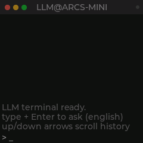
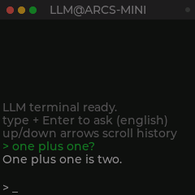
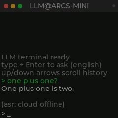

# ARCS-MINI LLM 终端

一套离线优先的 LLM 对话终端，完整运行在 [LISTENAI ARCS-MINI](../../../arcs-mini)
（RISC-V 双核 SoC，240×240 LCD）上。微型 GPT-Neo 模型在 AP 核执行，
CP 核上的 macOS 风格 LVGL 终端逐 token 渲染回答——不需要键盘，也不依赖云端大模型。




*开发板在自己回答问题——LLM 完全跑在设备上。*

## 功能特性

- **端侧 LLM** —— TinyTalk（GPT-Neo，256 维 / 8 层，5.8 MB 权重 flash XIP），
  由 AP 核常驻服务承载；~442ms/token，英文提问，经跨核 mailbox IPC 逐 token 流式回传。
- **LVGL 终端桌面** —— 全屏 macOS Terminal 风格 UI（信号灯、问题绿色回显、
  答案浅色），固件唯一桌面。打字机流式显示，↑/↓ 回看历史。
- **网络键盘（UDP）** —— 在 PC 上打字，设备屏幕实时回显。发现、逐键输入、
  心跳，见 `tools/llmkb/llm_keyboard.py`。
- **按住说话 ASR** —— 按住功能键（PB4）说英文，松开后 AIUI 云端 IAT 识别结果
  自动作为提问提交。录音上限 5 秒，按住 8 秒 = 关机。
- **整段 TTS 朗读** —— 生成完成后整段答案一次合成、一段完整播放；
  终端模式下语音会话夹带的平台推销/欠费话术会被过滤。
- **离线韧性** —— 无 WiFi 时 LLM 问答照常；ASR/TTS 提示降级，不影响终端。



## 架构

```
 ┌── CP 核（业务，hart 1）───────────────────┐   ┌── AP 核（算法，hart 0）──┐
 │ term_ui   LVGL 终端（worq.ui）            │   │ llm_service              │
 │ tts_speak 整段云端 TTS                    │   │  TinyTalk GPT-Neo        │
 │ voice_asr PB4 按住说话 → AIUI IAT         │   │  逐 token 流式生成       │
 │ net_kb    UDP 网络键盘 :38001             │   └────────────┬─────────────┘
 │ llm_client  多订阅者 IPC 客户端 ◄─────────┼── mailbox SRAM ┘（flush/inval）
 └───────────────────────────────────────────┘
```

## 构建

```bash
source ./arcs-sdk/env.sh                 # 工具链 + 环境（必须 source）

# CP 固件（终端应用）
./build.sh -S ./apps/arcs-mini -DBOARD=arcs_mini

# AP 固件（最小 LLM 服务，含嵌入权重 ~6 MB）
./build.sh -S ./apps/remote-ap -B build-remote-ap -DBOARD=arcs_mini
```

产物：`build/arcs-mini.bin`、`build-remote-ap/remote-ap.bin`。

## 烧录

ADB（推荐，仅 CP 应用）：

```bash
bash adb_download.sh -S res/arcs-mini app
```

全量 / 串口（cskburn）流程见 `CLAUDE.md`。

## 使用

1. 开机——终端直接启动为 `LLM@ARCS-MINI` 桌面。
2. **打字** —— 同一局域网内运行 PC 键盘：
   ```bash
   python3 tools/llmkb/llm_keyboard.py    # 自动发现设备
   ```
   打字 + 回车；问题绿色回显，答案流式打出。
3. **说话** —— 按住功能键，说一句英文，松开。识别文本自动提交。
4. **听** —— 生成完成后整段朗读答案。

运行时开关（adb shell 或串口）：

```text
llmterm tts on|off     答案朗读（默认开）
llmterm asr on|off     按住说话（默认开）
llmterm asr inject <文本>   模拟一条识别结果
llmterm stat           ip / 键盘 / llm / tts / asr 状态
```

### adb shell 手动配置 WiFi

终端没有配网界面——通过 adb 手动连网：

```bash
adb shell "wifi connect 你的SSID 你的密码"    # 连接并保存（开放网络可省略密码）
adb shell "wifi list"                         # 已保存的网络
adb shell "wifi scan"                         # 扫描周边热点
```

凭据会持久化，设备重启后自动重连。WiFi 就绪后 ASR/TTS 与网络键盘
随之可用（`llmterm stat` → `cloud=1`）。

## 说明与限制

- 端侧模型是 TinyStories 训练的 TinyTalk：**仅英文**、短事实性回答、
  偶尔一本正经地胡说。它是 footprint 演示，不是 ChatGPT。
- ASR/TTS 使用聆思云（需 WiFi + LSC 会话），与产品共享月度交互额度；
  LLM 问答本身永不离开设备。
- 模拟器：整套栈可在 [Lisem](https://github.com/LISTENAI/Lisem)（QEMU）
  下运行——上面的截图即来自模拟器，无需真机。

## 更多

- 原方案 README：[README-firmware.MD](README-firmware.MD)
- English: [README.md](README.md)
